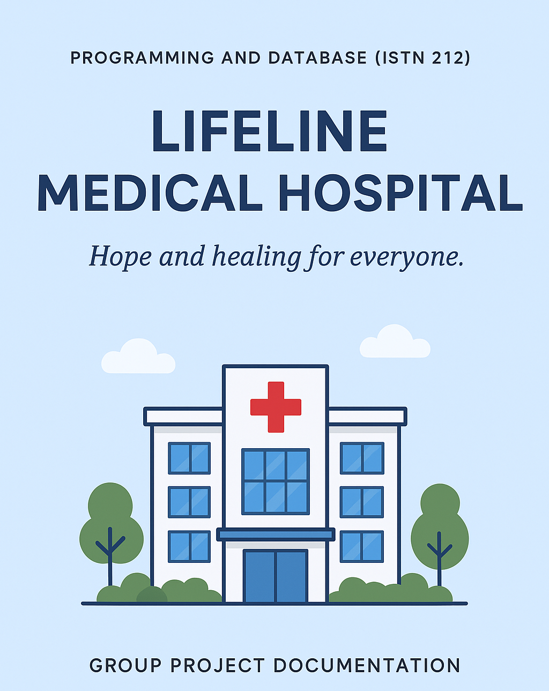
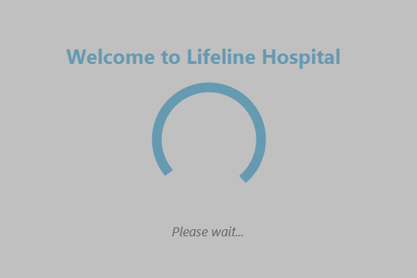
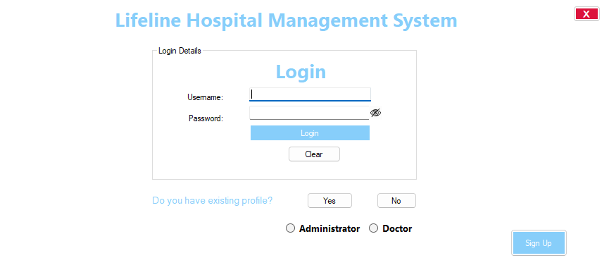
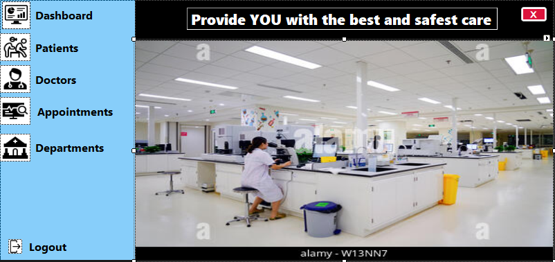

<p align="center">
  
</p>

# 🏥 Lifeline Medical Hospital: Doctor Appointment Booking System

A **C# Windows Forms desktop application** that replaces walk-in queues at a state-owned hospital with a structured appointment booking process. Administrators register patients, manage departments and doctors, and book appointments, while doctors manage patient medical records. The system validates South African ID numbers, auto-fills patient details and gives management a dashboard of key figures.

> 🎓 **Module:** Programming and Database (ISTN 212) · University of KwaZulu-Natal
> 👥 **Type:** Group project (Jul to Dec 2025) · **My role:** Project Leader, managing the full SDLC from requirements analysis and design to development and testing

---

## 🎯 The problem

Lifeline Hospital serves a large community and offers specialist care (cardiology, dermatology, neurology, paediatrics, orthopaedics, general medicine and more). Without a formal appointment system, patients walk in and wait for hours. This causes overcrowding, patient dissatisfaction, and lost or delayed appointments.

## 💡 The solution

A booking application that lets hospital staff schedule appointments by specialty, keeps accurate patient and doctor records, and gives administrators and doctors separate, role-based workspaces. The result is shorter waiting times, better use of doctors' time and more reliable records.

---

## ✨ Key features

- **Animated splash screen** with a loading indicator while the system starts
- **Secure login** with Administrator and Doctor roles, show/hide password and a strong-password rule
- **Admin dashboard** showing total patients, total doctors and appointments made each day
- **Patient management:** add, update and delete patient records
- **Doctor management:** add, update, delete and search doctors by name
- **Department management:** add, update and delete departments
- **Appointment management:** add, update, delete and book appointments
- **Smart booking form:** enter a 13-digit South African ID number and the system validates it and auto-fills date of birth, gender and age
- **Province and city selection**, date and time picker, appointment summary and print option
- **Doctor portal** for viewing, adding, updating and deleting patient medical records

---

## 🧰 Tech stack

| Layer | Technology |
|---|---|
| Language | C# |
| Framework | .NET Framework, Windows Forms |
| IDE | Visual Studio 2022 |
| Database | SQL relational database (parameterised queries) |
| Version control | Git & GitHub |
| Methodology | SDLC, team collaboration |

---

## 📸 Screenshots








---

## 🚀 Getting started

### Prerequisites
- Windows 10 or 11
- [Visual Studio 2022](https://visualstudio.microsoft.com/) with the **.NET desktop development** workload
- A SQL database set up for the application (see the documentation for the tables used)

### Run the application

```bash
# 1. Clone the repository
git clone https://github.com/musahhh4/Doctor-Appointment-Booking-System.git

# 2. Open the solution file (.sln) in Visual Studio

# 3. Update the database connection string to point to your own database

# 4. Build the solution (Ctrl + Shift + B)

# 5. Start the application (F5)
```

The application starts with the splash screen and then opens the **Login** page. Choose **Administrator** or **Doctor** to continue.

---

## 🗺️ How the application flows

`Splash screen` → `Login` → **Admin:** `Dashboard · Patients · Doctors · Appointments · Departments` → `Book Appointment`
`Splash screen` → `Login` → **Doctor:** `Medical Records · Doctors`

---

## 📚 Documentation

Full documentation (problem, solution, requirements, form-by-form description, validation rules, testing and future improvements) is in **[docs/DOCUMENTATION.md](docs/DOCUMENTATION.md)**.

---

## 🔒 Security and privacy note

No real credentials, patient data or student numbers are stored in this repository. Database connection strings and passwords must be kept out of source control. Any sample data used for demonstration should be fictional.

---

## 🔮 Future improvements

- Patient self-service portal for booking online
- Email and SMS appointment confirmations and reminders
- Hashed and salted password storage and role-based audit logs
- Calendar view for doctors' availability
- Reports (appointments per department, busiest days)
- Compliance review against POPIA for handling medical information
- Unit tests for ID-number validation and booking logic

---

## 👥 Project team

Asanda Jele · Minenhle Ndlovu · Nomcebo Zulu · **Bongumusa Gumede (Project Leader)** · Halalisani Ngcobo · Lungisani Mnyandu

---

## 👤 Author

**Bongumusa Seluleko Gumede**
BCom Information Systems & Technology, University of KwaZulu-Natal
🔗 [LinkedIn](https://www.linkedin.com/in/bongumusagumede/) · 💻 [GitHub](https://github.com/musahhh4)
