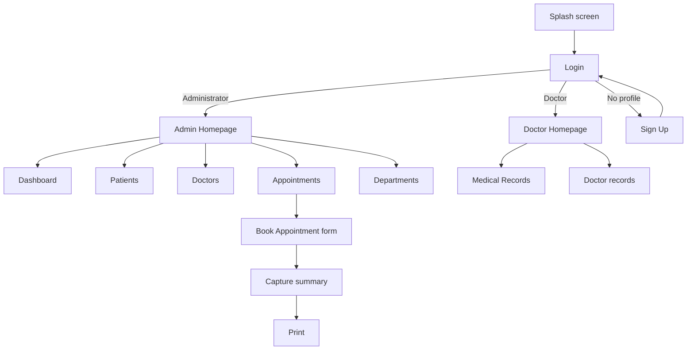

# Lifeline Medical Hospital: Doctor Appointment Booking System Documentation

| | |
|---|---|
| **Project name** | Lifeline Medical Hospital Booking System (Lifeline Hospital Management System) |
| **Module** | Programming and Database (ISTN 212) |
| **Institution** | University of KwaZulu-Natal |
| **Type** | Group project, Jul to Dec 2025 |
| **Original documentation date** | 06 October 2025 |
| **Project Leader** | Bongumusa Seluleko Gumede |
| **Team** | Asanda Jele, Minenhle Ndlovu, Nomcebo Zulu, Bongumusa Gumede, Halalisani Ngcobo, Lungisani Mnyandu |
| **Tools** | C#, .NET Framework, Windows Forms, Visual Studio 2022, SQL database, Git/GitHub |

---

## Table of contents

1. [Introduction](#1-introduction)
2. [Problem statement](#2-problem-statement)
3. [Proposed solution](#3-proposed-solution)
4. [Objectives and scope](#4-objectives-and-scope)
5. [Requirements](#5-requirements)
6. [System overview and flow](#6-system-overview-and-flow)
7. [Form-by-form description](#7-form-by-form-description)
8. [Validation rules](#8-validation-rules)
9. [Database notes](#9-database-notes)
10. [Testing](#10-testing)
11. [Security and privacy](#11-security-and-privacy)
12. [Skills demonstrated](#12-skills-demonstrated)
13. [Limitations and future improvements](#13-limitations-and-future-improvements)
14. [Conclusion](#14-conclusion)
15. [How to run](#15-how-to-run)

---

## 1. Introduction

This document describes a **Windows Forms** application built in **C#** on **Visual Studio 2022 (.NET Framework)** for **Lifeline Medical Hospital**, a state-owned healthcare facility. The system replaces the traditional walk-in method, which causes long queues and overcrowding, with a structured and automated appointment booking process.

The application is made up of several connected forms, each with a distinct purpose in the hospital workflow: secure login, administrative management, appointment scheduling and medical record handling. It lets users register patients, book and manage appointments, validate patient information, and view or update medical records. Patients are attended to promptly, and doctors and administrators can manage operations easily.

## 2. Problem statement

Lifeline Hospital is a community-based hospital that offers a wide range of services and specialist treatment, including cardiology, dermatology, neurology, paediatrics, orthopaedics and general medicine. It serves a large number of people every day, most of whom rely on its affordable and accessible services.

Despite this, the hospital suffers from long queues and long waiting periods. Patients spend hours waiting, not because staff are busy, but because there is no formal and effective appointment system. The walk-in method leads to:

- overcrowding
- patient dissatisfaction
- lost or delayed appointments

## 3. Proposed solution

The project proposes a hospital booking application that allows appointments to be made by specialty (cardiology, dermatology, neurology, paediatrics, orthopaedics and so on) with confirmation of the booking. The system is intended to:

- reduce unnecessary waiting time
- make hospital processes smoother
- manage doctors' schedules better
- allocate resources efficiently and optimise patient flow
- improve the accuracy of patient records
- improve the patient experience and contribute to better healthcare delivery

## 4. Objectives and scope

**Objectives**
- Replace walk-in queues with scheduled appointments.
- Give administrators and doctors separate, role-based workspaces.
- Capture accurate patient information, using ID-number validation to reduce data-entry errors.
- Give management a quick overview through a dashboard.
- Give doctors easy access to patients' medical records.

**In scope**
- Splash screen and login with roles (Administrator, Doctor)
- Admin homepage with Dashboard, Patients, Doctors, Appointments and Departments
- Patient, doctor, department and appointment management (add, update, delete)
- Appointment booking form with ID-number validation and auto-fill
- Doctor homepage with medical record management and doctor records

**Out of scope (current version)**
- Patient self-service booking over the web or mobile
- Email or SMS notifications
- Billing and payments
- Integration with national health systems

## 5. Requirements

### 5.1 Functional requirements

| ID | Requirement |
|---|---|
| FR1 | The system shall show a splash screen with a loading indicator while it starts. |
| FR2 | The system shall authenticate Administrators and Doctors with a username and password. |
| FR3 | The system shall enforce a strong password (uppercase, lowercase, digit, special character, longer than 8 characters) and show an error label when the rule is not met. |
| FR4 | The system shall let users show or hide the typed password and clear the login fields. |
| FR5 | The system shall show "Login successfully" on success and direct the user to the Admin or Doctor homepage according to their role. |
| FR6 | The system shall let new users create a profile through a Sign Up option. |
| FR7 | The Admin homepage shall give access to Patients, Dashboard, Doctors, Appointments and Departments. |
| FR8 | Administrators shall be able to add, update and delete patients, departments and appointments. |
| FR9 | The Dashboard shall show total patients, total doctors and appointments made each day. |
| FR10 | The booking form shall capture full name, ID number, province, city and the date and time of the appointment. |
| FR11 | The system shall validate the ID number when the user leaves the field and auto-fill date of birth, gender and age from a valid ID. |
| FR12 | The system shall show an error ("ID number is not valid") and block dependent fields while the ID number is invalid. |
| FR13 | The Capture button shall show the appointment summary in a list box, and Print shall print it. |
| FR14 | Doctors shall be able to view, insert, update and delete patient medical records. |
| FR15 | Doctors shall be able to view and maintain doctor records and search doctors by name. |

### 5.2 Non-functional requirements

| ID | Requirement |
|---|---|
| NFR1 | **Usability:** a professional, consistent interface with clear navigation buttons and icons. |
| NFR2 | **Data quality:** inputs are validated so that invalid data does not enter the system. |
| NFR3 | **Security:** role-based access and a strong-password policy; database queries use parameters. |
| NFR4 | **User experience:** animated splash screen and saving animations give clear feedback. |
| NFR5 | **Maintainability:** separate forms for each responsibility. |

## 6. System overview and flow



## 7. Form-by-form description

### 7.1 Splash screen (progress bar)


When the application starts, a progress screen appears with the text **"Welcome to Lifeline Hospital"**, a circular loading icon and **"Please wait..."**. It stays on screen until the system is ready for the user to interact with it.

### 7.2 Form 1: Login page


**Purpose:** authenticate users and grant access to the system.

**Interface components**
- **Username:** input field for the username.
- **Password:** input field for the password, with a show/hide eye icon.
- **Administrator / Doctor** radio buttons to choose the role.

**Password rule:** the system forces a strong password containing uppercase and lowercase letters, digits and special characters, with a length greater than 8. If the rule is not met, a label tells the user what is wrong.

**Action buttons**
- **Login:** submits credentials for existing Admin or Doctor accounts. On success a message box shows "Login successfully", and the user is taken to the Admin or Doctor homepage.
- **Clear:** clears the entered credentials.
- **"Do you have an existing profile?" (Yes / No):** if the user selects No, the **Sign Up** button lets them create a new profile.

### 7.3 Admin homepage


The primary interface for administrative tasks, with quick access to the key features. The tagline reads "Provide YOU with the best and safest care".

**Navigation buttons**
- **Patients:** the Patients homepage, where administrators manage patient information.
- **Dashboard:** insights and analytics on key metrics.
- **Doctors:** the Doctors page, where administrators manage doctor records.
- **Appointments:** the Appointments homepage, where administrators manage appointments and bookings.
- **Departments:** the Department homepage, where departmental information is managed.
- **Logout:** ends the session.

> The image above was taken in the Visual Studio designer. The stock photo carries a watermark; replace it with a licensed or free-to-use image before final submission.

**Patient management:** add new patients, update existing patient details and delete patient records.

**Department management:** add new departments, update department details and delete department records.

**Dashboard insights**
- **Total patients:** the number of patients in the system.
- **Total doctors:** the number of doctors in the system.
- **Appointments made each day:** the number of appointments scheduled per day.

**Appointment management:** add, update and delete appointments, and **Book an appointment** to schedule a patient with a doctor.

### 7.4 Book Appointment form
When **Book appointment** is clicked, the system opens the bookings form. Its goal is to let the admin enter a patient's personal details, capture appointment data and manage the booking.

| Control | Purpose |
|---|---|
| **Full name** textbox | Captures the complete, legal name of the person booking. |
| **ID Number** textbox | Identifies the patient correctly; validates the number and auto-fills personal details. |
| **Province** combo box | The nine provinces; the user selects the one where they live. |
| **City** combo box | The city within the selected province. |
| **Date time picker** | Selects the date and time of the appointment. |
| **Capture** button | Shows the appointment summary in the list box. |
| **Print** button | Prints the appointment details shown in the list box. |

**ID number validation and data extraction** (runs when the user leaves the textbox)
- **Validation:** the system checks the format and length (13 digits, South African ID format), that the date inside the number is valid, and any checksum or logical rules in place.
- **Error handling:** for an invalid number, the system shows **"ID number is not valid"** as soon as the user leaves the field, and no dependent fields are generated until the number is valid.
- **Auto-fill from a valid ID:**
  - **Date of birth:** taken from the first six digits of the ID number (YYMMDD).
  - **Gender:** taken from the sequence digits (7 to 10): a value below 5000 means female, 5000 or above means male.
  - **Age:** calculated from the date of birth and the current system date.

### 7.5 Doctor homepage


A portal for doctors to manage and access patients' medical records.

**Navigation buttons**
- **Medical Records:** access patients' medical records.
- **Doctors:** the doctors' page, where they can modify their information.

**Medical management:** view and read medical records, insert new information, update existing information and delete information when required.

**Doctor management:** view doctor records, insert, update or delete their own information, and **search by DoctorName** using a parameterised query:

```sql
SELECT DoctorID, DoctorName, Specialization, EmailAddress, PhoneNo
FROM DOCTOR
WHERE (DoctorName LIKE @name + '%')
```

## 8. Validation rules

| Area | Rule | Feedback to the user |
|---|---|---|
| Password | Uppercase, lowercase, digit, special character, longer than 8 characters | Error label on the login form |
| ID number | 13 digits, valid date inside the number, checksum or logical rules | "ID number is not valid" on leaving the field |
| Dependent fields | Date of birth, gender and age are generated only from a valid ID | Fields stay empty until the ID is valid |
| Login | Username and password must match an existing user and the selected role | Error message; "Login successfully" on success |
| Province and city | Only one province can be chosen, with its own cities | Enforced by the combo boxes |
| Search | Doctor search matches names that start with the typed text | Results list filters as typed |

## 9. Database notes

- The application stores patients, doctors, departments, appointments and medical records in a **SQL database**.
- Queries use **parameters** (for example `@name`) rather than building SQL by concatenating user input, which protects against SQL injection.
- The `DOCTOR` table includes the columns `DoctorID`, `DoctorName`, `Specialization`, `EmailAddress` and `PhoneNo`.

> Add your own entity-relationship diagram and table list here (for example PATIENT, DOCTOR, DEPARTMENT, APPOINTMENT, MEDICAL_RECORD) once you have confirmed the final schema.

## 10. Testing

Test the running application and record the real result for each scenario.

| ID | Scenario | Steps | Expected result | Result |
|---|---|---|---|---|
| T1 | Splash screen | Start the application | Welcome screen with loading icon appears, then the login page | Add your own result |
| T2 | Weak password | Enter a short password without special characters | Error label explains the rule | Add your own result |
| T3 | Valid admin login | Log in as Administrator | "Login successfully", Admin homepage opens | Add your own result |
| T4 | Valid doctor login | Log in as Doctor | "Login successfully", Doctor homepage opens | Add your own result |
| T5 | Clear button | Click **Clear** | Username and password are cleared | Add your own result |
| T6 | Show/hide password | Click the eye icon | Password becomes visible or hidden | Add your own result |
| T7 | Sign up | Select **No** for existing profile, then **Sign Up** | New profile can be created | Add your own result |
| T8 | Invalid ID number | Enter a 12-digit or invalid ID and leave the field | "ID number is not valid", dependent fields not generated | Add your own result |
| T9 | Valid ID number | Enter a valid 13-digit ID and leave the field | Date of birth, gender and age auto-filled correctly | Add your own result |
| T10 | Capture and print | Complete the form, click **Capture**, then **Print** | Summary shown in the list box and printed | Add your own result |
| T11 | Patient CRUD | Add, update and delete a patient | Changes are saved and shown | Add your own result |
| T12 | Dashboard | Open Dashboard after adding data | Totals and daily appointments are correct | Add your own result |
| T13 | Doctor search | Type the start of a doctor's name | Only matching doctors are listed | Add your own result |
| T14 | Medical record update | Insert, update and delete a record as a doctor | Changes are saved and shown | Add your own result |

## 11. Security and privacy

- **No credentials in the repository.** Test login details, database passwords and connection strings must never be committed. Use local configuration files that are excluded by `.gitignore`.
- **Passwords:** store them **hashed and salted**, never as plain text.
- **Role-based access:** only Administrators see administrative features, and only Doctors see medical records.
- **SQL injection:** use parameterised queries throughout (as in the doctor search).
- **Medical information is sensitive.** Under South Africa's **POPIA**, personal and health information needs lawful, secure handling. Use only fictional data in demos and screenshots.
- **Student numbers and personal details** of team members are not published in this repository.

## 12. Skills demonstrated

- **Project leadership:** planning, delegating and coordinating a team through the SDLC (requirements, design, development, testing).
- **Windows Forms (.NET) development:** multi-form application with buttons, text boxes, combo boxes, date/time pickers, list boxes, radio buttons and picture boxes.
- **Database programming:** SQL queries with parameters, CRUD operations and search.
- **Input validation:** password strength rules and South African ID-number validation with data extraction.
- **Role-based design:** separate Admin and Doctor workspaces.
- **Business analysis:** turning a real-world problem (hospital queues) into functional requirements and a solution.
- **UI and UX design:** consistent look, navigation icons, splash screen and saving animations.
- **Documentation:** form-by-form system documentation.
- **Team collaboration:** shared development with Git and GitHub.

## 13. Limitations and future improvements

**Current limitations**
- Windows desktop only; patients cannot book for themselves online.
- No notifications for appointment confirmation or reminders.
- Reporting is limited to the dashboard.

**Future improvements**
- Patient self-service portal (web or mobile)
- Email and SMS confirmations and reminders
- Doctor availability calendar and automatic conflict detection
- Reports by department, doctor and day
- Hashed passwords, audit logs and a POPIA compliance review
- Unit and integration tests
- Cloud hosting and a central database

## 14. Conclusion

The Lifeline Medical Hospital Booking System improves efficiency, reduces patient waiting time and strengthens healthcare management. It gives administrators and doctors a solid platform for managing appointments and patient data, supporting smoother hospital operations and a better patient experience. The professional interface, together with features such as the animated splash screen and saving animations, shows attention to both technical functionality and user experience.

## 15. How to run

1. Install **Visual Studio 2022** with the **.NET desktop development** workload.
2. Clone the repository:
   ```bash
   git clone https://github.com/musahhh4/Doctor-Appointment-Booking-System.git
   ```
3. Open the solution (`.sln`) file in Visual Studio.
4. Set up the SQL database and update the connection string to your own database.
5. Build the solution (**Ctrl + Shift + B**) and run it (**F5**).

---

*Document version 1.0 · Project Leader: Bongumusa Seluleko Gumede*
